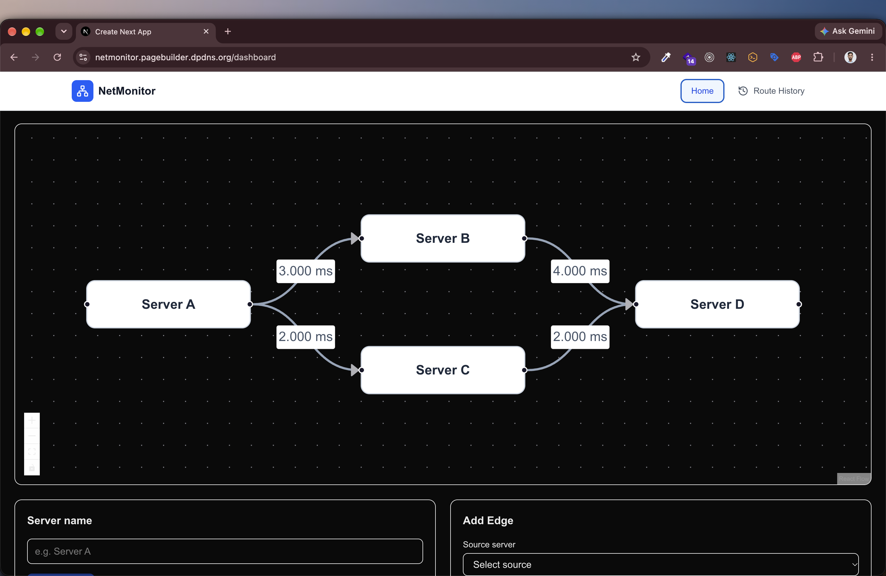
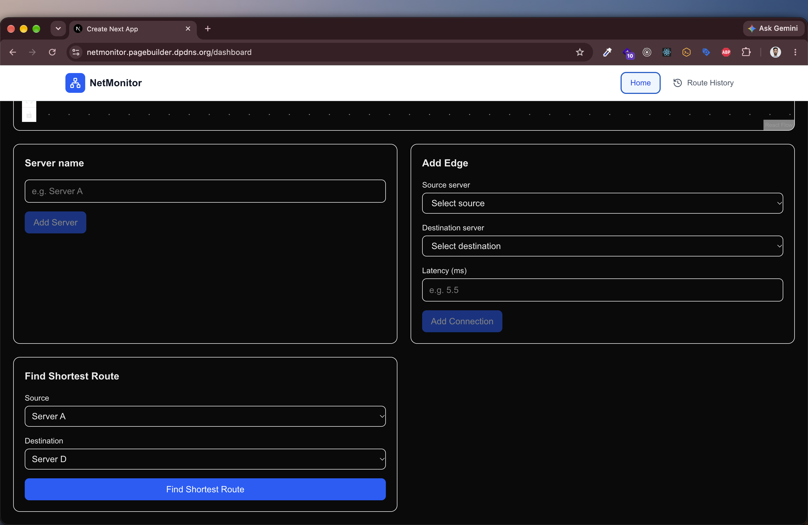
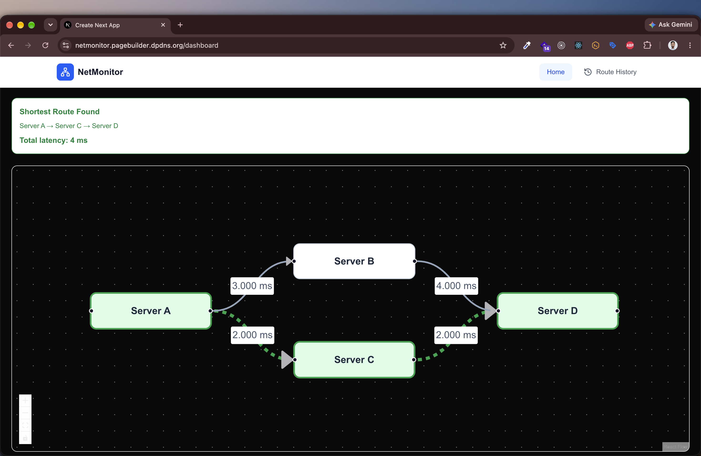
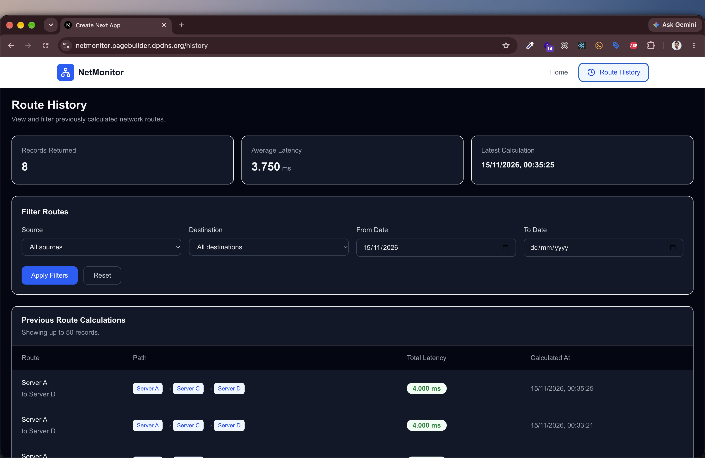

# Network Optimizer
## Live Url:
   https://netmonitor.pagebuilder.dpdns.org/

## Project Architecture

The project follows a Monorepo Architecture.

### Tech-Stack:
* Frontend:  NextJs, ReactFlow, TailWind CSS
* Backend: Python, Django, Django-Rest-Framework, MySql
* Deployment: Oracle Cloud Infrastructure, Nginx, Gunicorn, Linux, SSL/HTTPS (Certbot)

### Repository Structure
```text
         ├── backend
         │   ├── common/
         │   ├── manage.py
         │   ├── network/
         │   ├── network_optimizer/
         │   └── requirements.txt
         ├── frontend
         │   ├── AGENTS.md
         │   ├── app/
         │   ├── components/
         │   ├── eslint.config.mjs
         │   ├── next-env.d.ts
         │   ├── next.config.ts
         │   ├── node_modules
         │   ├── package-lock.json
         │   ├── package.json
         │   ├── public/
         │   ├── README.md
         │   ├── services/
         │   └── tsconfig.json
         └── Readme.md
```

## Features
   * Node Management: Create and retrieve network nodes.
   * Edge Management: Create and manage directed connections between nodes with configurable latency.
   * Shortest Path Calculation: Find the optimal route between two nodes using Dijkstra's shortest-path algorithm.
   * Graph Visualization: An interactive frontend to visualize graph and path finder algorithm.
   * Route Highlighting: Display the selected shortest path within the network graph.
   * Route History: Store and retrieve previously calculated routes.
   * API-based Architecture: Separate backend and frontend applications communicating through REST APIs.

## Screenshot
### Dashboard

### Dashboard Forms

### Path Calculation Visualization

### History


## Architecture
   The application follows client-server architecture
   ```text
              User
                   |
                   v
          Next.js Frontend
          (Port 3000)
                   |
                   | REST API
                   v
             Nginx Server
                   |
          /api/    |    /
             |     |     |
             v     |     v
       Django API  |  Next.js
       Gunicorn    |  Frontend
       Port 8001   |
             |
             v
           MySQL
   ```

## Shortest Path Algorithm 
   The project uses *Dijkstra's Algorithm* to calculate the shortest path between two nodes.
### Services
   * **adjacency_list**: Nodes and Edges form a graph and this graph is represented by adjacency list. This service create adjacencey list from the tables network_node and network_edge tables.
   * **path_finder**: Utilizes *adjacencey list* created by ```adjacency list service``` to perform *Dijkstra's Algorithm* to find shortest path.

## 🗄️ Database Design

The application uses MySQL as its primary relational database.

### Node
Represents a network node.

| Field | Description |
|---|---|
| id | Primary key |
| name | Unique node name |
| slug | Unique URL-friendly identifier |
| created_at | Creation timestamp |
| modified_at | Last update timestamp |

### Edge
Represents a directed connection between two nodes.

| Field | Description |
|---|---|
| id | Primary key |
| source | Source node (Foreign Key) |
| destination | Destination node (Foreign Key) |
| latency | Connection latency |
| created_at | Creation timestamp |
| modified_at | Last update timestamp |

### RouteHistory
Stores information about previously calculated routes.

| Field | Description |
|---|---|
| id | Primary key |
| source | Starting node |
| destination | Destination node |
| path | Json Field to store path |
| total_latency | Total route latency |
| created_at | Route calculation timestamp |
| modified_at | Last update timestamp |


## 🔌 API Endpoints
```text
   /api/network/edges/	network.views.EdgeModelViewSet	edges-list
   /api/network/edges/<pk>/	network.views.EdgeModelViewSet	edges-detail
   /api/network/nodes/	network.views.NodeModelViewSet	nodes-list
   /api/network/nodes/<pk>/	network.views.NodeModelViewSet	nodes-detail
   /api/network/routes/history/	network.views.RouteHistoryAPIView	history-routes
   /api/network/routes/shortest/	network.views.ShortestRouteAPIView	shortest-route
```

Base URL:

`/api/network/`

### 1. Node Management

| Method | Endpoint | Description |
|---|---|---|
| GET | `/api/network/nodes/` | Retrieve network nodes |
| GET | `/api/network/nodes/<pk>` | Retrieve network nodes detail |
| POST | `/api/network/nodes/` | Create a network node |

### 2. Edge Management

| Method | Endpoint | Description |
|---|---|---|
| GET | `/api/network/edges/` | Retrieve network edges |
| GET | `/api/network/edges/<pk>` | Retrieve network edges detail |
| POST | `/api/network/edges/` | Create a network connection |

### 3. Shortest Path

| Method | Endpoint | Description |
|---|---|---|
| POST | `/api/network/routes/shortest/` | Calculate shortest route |

Example request:

```json
{
    "source": "node-a",
    "destination": "node-d"
}
```

### 4. Route History

| Method | Endpoint | Description |
|---|---|---|
| GET | `/api/network/routes/history/` | Retrieve route history |

Supported query parameters:

| Parameter | Description |
|---|---|
| source | Filter by source node |
| destination | Filter by destination node |
| limit | Maximum number of records |
| date_from | Filter routes from a date |
| date_to | Filter routes up to a date |

## Local Development Setup

### Prerequisites

- Python 3.13.5
- Node.js and npm
- MySQL 8+
- Git

### 1. Clone the Repository

```bash
git clone https://github.com/khanforge/network_optimizer.git
cd network_optimizer
```

### 2. Backend Setup

```bash
cd backend

python3 -m venv venv

# Linux / macOS
source venv/bin/activate

pip install -r requirements.txt

cp local_settings_example.py local_settings.py
```

In local_settings.py set required variables: SECRET_KEY, CORS_ALLOWED_ORIGINS, DATABASES

Create the MySQL database:

```sql
CREATE DATABASE network_optimizer;
```

Apply migrations:

```bash
python manage.py makemigrations
python manage.py migrate
```

Start the backend:

```bash
python manage.py runserver
```

### 3. Frontend Setup

Open another terminal:

```bash
cd frontend
npm install
```

Create a `.env.local` file:

```env
NEXT_PUBLIC_API_BASE_URL=http://127.0.0.1:8000/api/
```

Start the frontend:

```bash
npm run dev
```

Frontend development server:

`http://localhost:3000/`